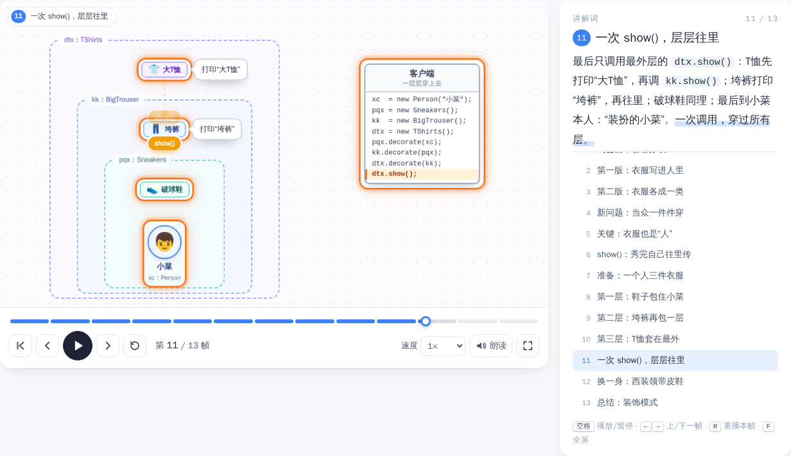

# 大话设计模式 · 逐帧动画图解

把《大话设计模式》中的 **24 个设计模式 + 6 条设计原则**，做成可以一帧一帧看的小动画，每帧配一段大白话讲解。
写给“书看完了，却什么都没记住”的人。

**在线访问：** https://yangqing-lin.github.io/dahua-design-patterns/ （部署方法见下文）




## 功能

- **逐帧动画**：共 355 帧，每个模式 10 帧左右——书中故事 → 痛点 → 角色逐个登场 → 消息流动 → 需求变化 → 总结口诀
- **播放控制**：播放 / 暂停、上一帧 / 下一帧、重播本帧、拖动分段进度条随意定位（拖动时画面实时跟随）、0.5×～2× 变速、全屏
- **讲解词**：右侧同步显示当前帧讲解，下方步骤列表可点击跳转；可开启浏览器语音朗读（朗读没结束会自动等待）
- **知识卡片**：书中故事、定义、生活类比、适用场景、优缺点、易混淆对比
- **代码骨架**：每个模式都有 Java / Python 3 / Go 三个版本（可切换，会记住你的选择，一键复制），Python 和 Go 版本都是可以直接运行的完整程序
- **巩固**：一句话口诀、一页纸速记、随机场景测验、学习进度（保存在浏览器本地）
- 快捷键：`空格` 播放/暂停，`←` `→` 上/下一帧，`R` 重播本帧，`F` 全屏，`Home` / `End` 首/末帧
- 深链接：`#/p/<模式id>/<帧号>`，如 `#/p/strategy/8`

## 本地运行

纯静态网站，无依赖、无构建：

```bash
python3 -m http.server 8765
# 打开 http://localhost:8765/
```

直接双击 `index.html`（`file://` 方式）也能用。

## 部署到 GitHub Pages

仓库里已经带好了 GitHub Actions 工作流（`.github/workflows/deploy-pages.yml`）：每次推送到 `main` 分支，会先检查
（JS 语法、内容完整性、运行全部 Python / Go 代码骨架），全部通过后自动发布。

1. 在 GitHub 新建一个仓库（例如 `dahua-design-patterns`），把本目录推送上去：

   ```bash
   git init
   git add .
   git commit -m "大话设计模式逐帧动画图解"
   git branch -M main
   git remote add origin https://github.com/<你的用户名>/<仓库名>.git
   git push -u origin main
   ```

2. 打开仓库 **Settings → Pages → Build and deployment → Source**，选择 **GitHub Actions**（只需设置一次）。
3. 到 **Actions** 页面查看“部署到 GitHub Pages”，第一次推送若在设置之前就已触发失败，点 **Re-run all jobs** 即可。
4. 完成后访问 `https://<你的用户名>.github.io/<仓库名>/`。

> 不想用 Actions 也可以：Source 选择 **Deploy from a branch**，分支选 `main`、目录选 `/ (root)`。网站全部使用相对路径和 hash 路由，放在任何子路径下都能正常工作。

## 目录

```
index.html            入口（每个模式一个 <script>）
css/style.css         样式
js/core.js            注册表、迷你标记、代码高亮（Java / Python / Go）、学习进度
js/engine.js          动画引擎：帧编译 / 插值渲染 / 播放器与控制条
js/app.js             路由与页面：首页、模式页、测验、联系表
patterns/*.js         每个模式 / 原则的内容、分镜和三种语言的代码骨架
tools/                开发辅助脚本（网站运行不需要）
screenshots/          README 用的截图
AUTHORING.md          如何编写或修改一个模式动画
.github/workflows/    GitHub Pages 自动检查与部署
```

## 参与修改

新增或修改模式请先读 [AUTHORING.md](AUTHORING.md)。改完后可以用这些脚本自检：

| 命令 | 作用 | 需要 |
|---|---|---|
| `node tools/lint.js` | 内容检查：必填字段、引用、index.html 是否引入 | Node.js |
| `node tools/check-code.js [id]` | 真实运行 Python / Go 代码骨架，检查 gofmt / go vet | Node.js、python3、Go |
| `node tools/shot.js <id>` | 截图全部帧，检查元素重叠 / 越界 | Playwright（`cd tools && npm install && npx playwright install chromium`） |
| `node tools/e2e.js` | 端到端测试：播放控制、所有页面无报错、测验 | Playwright |

`shot.js` 和 `e2e.js` 需要先在项目根目录起本地服务。开发时也可以访问 `#/sheet/<模式id>` 一次性查看某个模式的全部帧。

## 引擎原理

每个模式声明一组角色（nodes）、连线（links）和若干帧（frames）。帧只描述“相对上一帧的变化”，
引擎在加载时把它们展开成每一帧的完整状态，任意时刻的画面 = 上一帧状态到本帧状态的插值，
再叠加本帧的高亮、消息流和气泡。所以进度条可以任意拖动、倒退，画面始终是确定的。

## 声明

本项目是《大话设计模式》（程杰 著）的学习笔记，书中人物与故事情节的版权归原作者及出版社所有。
项目中的讲解、动画与代码均为重新编写，建议配合原书阅读。
